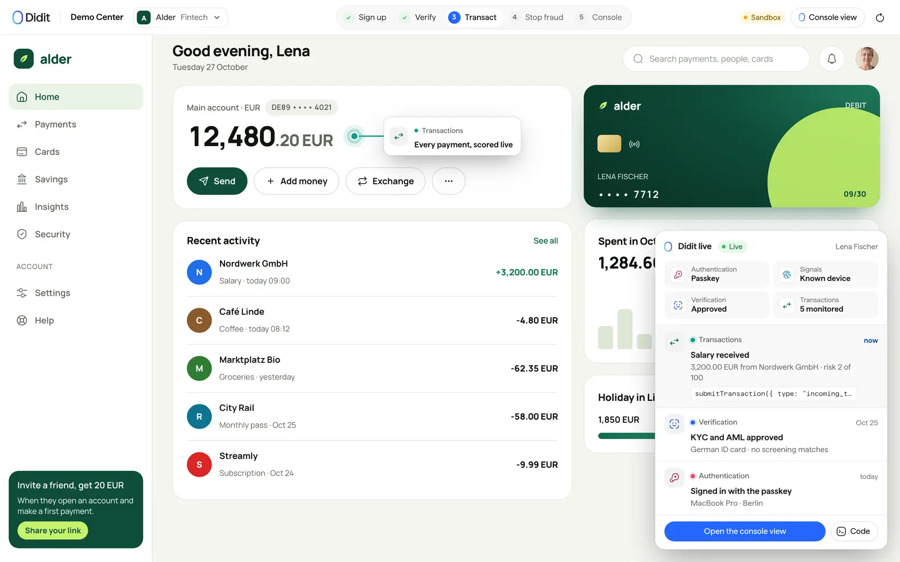
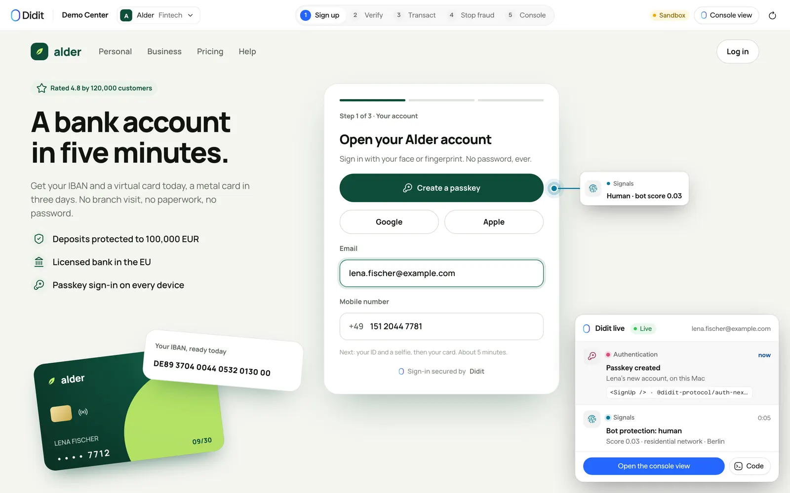
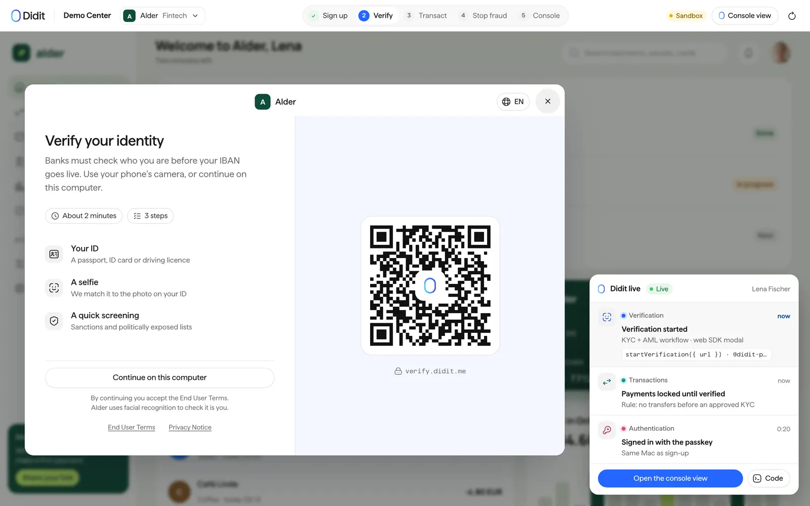
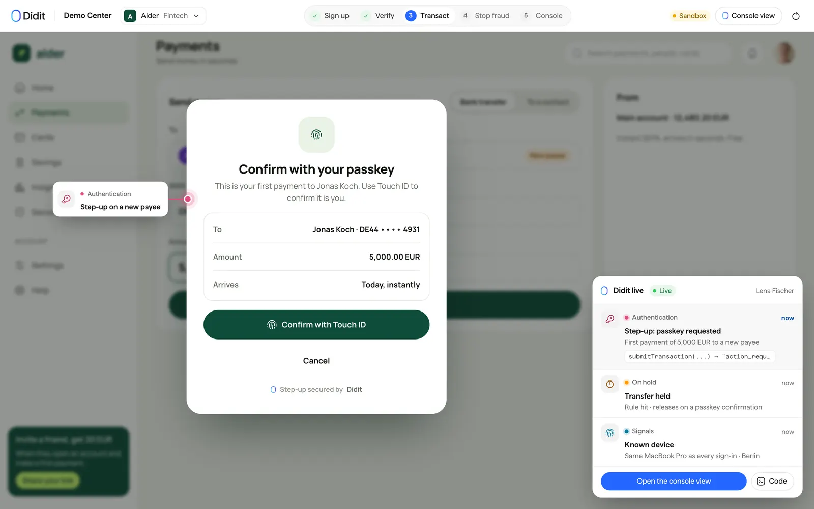
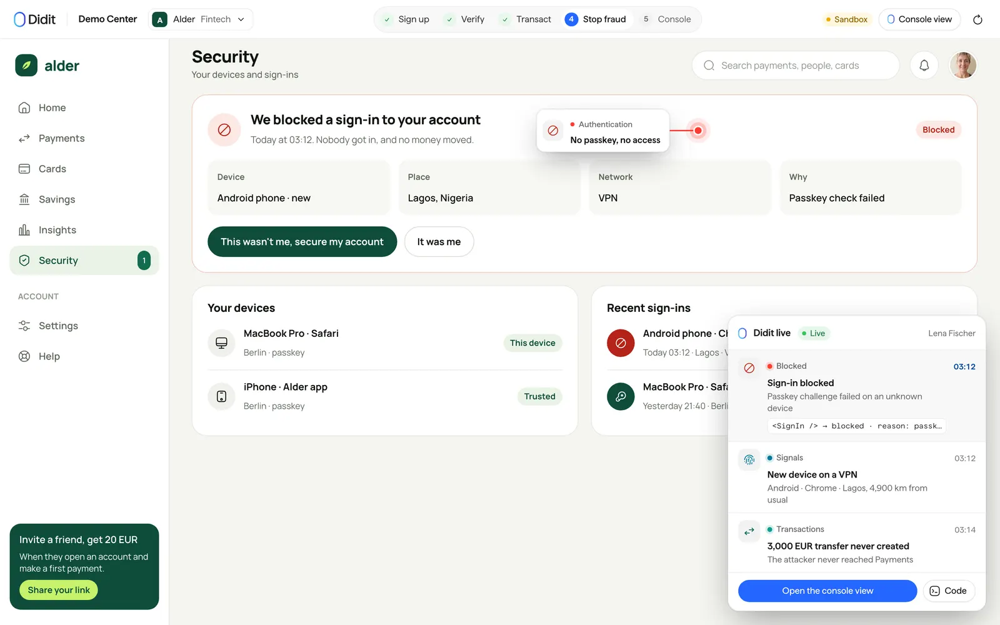
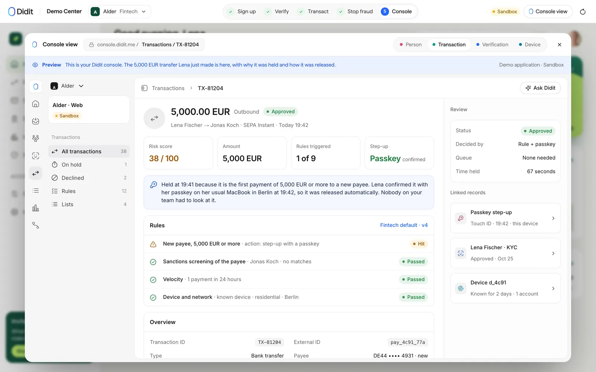
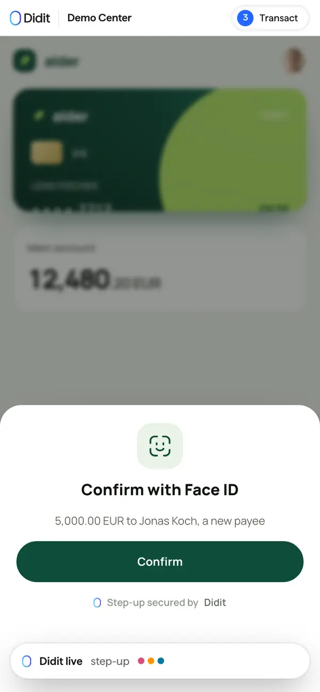
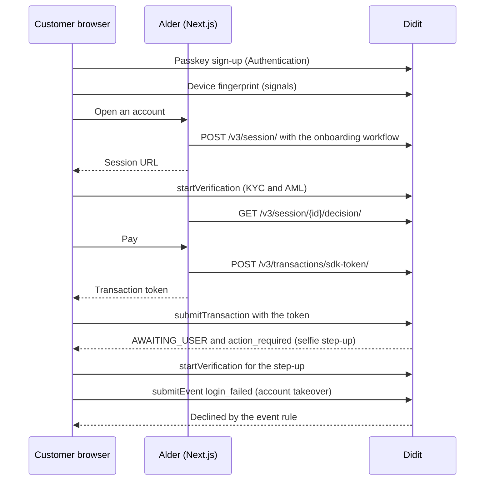

# Neobank KYC, AML screening and passkey sign-in with Didit (Next.js)

**Alder is an open-source Next.js reference app for a neobank that uses Didit for passkey sign-up, know your customer (KYC) and anti-money laundering (AML) checks before the IBAN, a selfie step-up on large transfers to a new payee, and account takeover protection at sign-in.**
It is for engineers and product owners at banks, payment companies and fintechs who want to see onboarding, Transaction Monitoring and step-up authentication working together in a real banking flow.
Every Didit call is real code you can read, run against your own Didit application and copy into your product.
The bank is fictional, the integration is not.



Topics: `neobank`, `fintech`, `kyc`, `aml`, `passkeys`, `passwordless`, `identity-verification`, `account-takeover`, `step-up-authentication`, `transaction-monitoring`, `fraud-prevention`, `nextjs`, `typescript`, `didit`, `reference-implementation`.

## What it shows

The app walks through five steps.
Each step names the Didit product and the call that does the work.

### 1. Open an account with a passkey (Didit Authentication)

A customer signs up in the bank's own page.
Passkey comes first, with Google, Apple and an email code as fallbacks.
The app wraps the page in `<DiditAuth>` from `@didit-protocol/auth-nextjs` and lets `diditAuthProxy` serve the sign-up, callback and session routes.



From `middleware.ts` (lines 11-26):

```ts
const proxy = publishableKey()
  ? diditAuthProxy(
      { afterSignOutUrl: "/" },
      {
        DIDIT_PUBLISHABLE_KEY: publishableKey() ?? undefined,
        DIDIT_REDIRECT_URI:
          process.env.DIDIT_REDIRECT_URI?.trim() ||
          `${diditUrls.site}/auth/callback`,
        DIDIT_SESSION_CACHE_SECONDS: process.env.DIDIT_SESSION_CACHE_SECONDS,
      },
    )
  : null;

export default function middleware(request: NextRequest) {
  return proxy ? proxy(request) : NextResponse.next();
}
```

Without a publishable key the app falls back to its own sign-up form and a signed customer cookie.

### 2. KYC and AML before the IBAN (Didit verification)

The server creates a Didit session for the customer with the onboarding workflow: ID check, liveness, face match, AML screening and IP analysis.
The browser opens the returned URL in the web SDK modal.
The IBAN goes live, and payments unlock, only after Didit approves the onboarding.



From `app/api/fintech/onboarding/route.ts` (lines 44-56):

```ts
const result = await didit.sessions.create({
  workflowId: ONBOARDING_WORKFLOW_ID,
  vendorData: customerId,
  callback: CALLBACK,
  email,
  metadata: {
    bank: BANK,
    step: "onboarding",
    ...(fullName ? { full_name: fullName } : {}),
  },
});

if (!result.ok || !result.data) {
```

From `lib/didit/browser.ts` (lines 49-58):

```ts
    void sdk.shared.startVerification({
      url,
      configuration: {
        showCloseButton: true,
        showExitConfirmation: true,
        closeModalOnComplete: true,
      },
    });
  });
}
```

### 3. A large transfer held for a selfie step-up (Didit Transaction Monitoring)

Every payment is submitted from the browser with `submitTransaction`, so the web SDK attaches the device fingerprint.
The server only mints a short-lived token for an approved customer.
A rule holds a transfer of 5,000 EUR or more to a new payee with `AWAITING_USER`.
The customer confirms with the passkey, then a selfie matched to the onboarding face releases the transfer.



From `lib/fintech/alder.ts` (lines 221-252):

```ts
export function newPayeeRule(stepUpWorkflowId: string) {
  return {
    title: RULE_TITLES.newPayee,
    description: `${BANK}: a transfer of ${STEP_UP_AMOUNT.toLocaleString("en-US")} ${CURRENCY} or more to a new payee is held until the customer confirms it is them. Only matches this demo's own customers.`,
    category: "finance",
    mode: "ACTIVE",
    evaluation_mode: "ALL",
    scope: { directions: ["OUTBOUND"], transaction_types: ["finance"] },
    conditions: [
      alderOnly,
      {
        field: `custom_values.${DEMO_PROPERTY.key}`,
        operator: "eq",
        value: DEMO_PROPERTY.value,
      },
      { field: "custom_values.new_payee", operator: "eq", value: true },
      { field: "currency", operator: "eq", value: CURRENCY },
      { field: "amount", operator: "gte", value: STEP_UP_AMOUNT },
    ],
    aggregation: [],
    actions: [
      {
        type: "change_status",
        value: "AWAITING_USER",
        workflow_id: stepUpWorkflowId,
      },
      { type: "add_tags", tag_name: "NEW_PAYEE_STEP_UP" },
    ],
  };
}

/**
```

### 4. Block an account takeover at sign-in (Didit signals and event rules)

A sign-in that cannot pass the passkey check is reported as a security event with `submitEvent` from `@didit-protocol/signals`.
An event rule declines it and tags it as an account takeover.



From `lib/fintech/alder.ts` (lines 256-279):

```ts
export function takeoverRule() {
  return {
    title: RULE_TITLES.takeover,
    description: `${BANK}: a sign-in that fails the passkey check is blocked as an account takeover. Only matches this demo's own customers.`,
    category: "fraud_prevention",
    mode: "ACTIVE",
    evaluation_mode: "ALL",
    scope: { record_types: ["event"], event_categories: ["security"] },
    conditions: [
      alderOnly,
      { field: "event.action_type", operator: "eq", value: "login_failed" },
      { field: "custom_values.passkey", operator: "eq", value: "failed" },
    ],
    aggregation: [],
    actions: [
      { type: "add_score", value: 90 },
      { type: "change_status", value: "DECLINED" },
      { type: "add_tags", tag_name: "ACCOUNT_TAKEOVER" },
    ],
  };
}

/** "Alder demo: 5,000 EUR or more to a new payee" → the rule's own words. */
export function ruleName(title: string): string {
```

### 5. See it in the console

The console view modal shows what each customer, payment and device looks like in the Didit Console, filled with the visitor's own data.
It is a preview drawn by the app, not an embedded console.



The app also works on a phone.



## How it works



## Features and where they live

| Capability | Didit product | Where in the code |
| --- | --- | --- |
| Passkey, Google, Apple and email-code sign-up | Authentication | `middleware.ts`, `app/layout.tsx`, `lib/didit/provider.tsx` |
| Device fingerprint and bot score | Signals SDK | `lib/didit/browser.ts`, `lib/didit/provider.tsx` |
| KYC and AML onboarding | Verification and AML screening | `app/api/fintech/onboarding/route.ts`, `scripts/lib/workflows.mjs` |
| Payments unlock after approval | Verification decision | `app/api/fintech/token/route.ts` |
| Monitored payments | Transaction Monitoring | `lib/fintech/alder.ts`, `components/fintech/use-alder.ts` |
| Selfie step-up on a new payee | Rules and biometric re-check | `lib/fintech/alder.ts` |
| Account takeover event | Signals and event rules | `app/api/fintech/monitoring-token/route.ts`, `lib/fintech/alder.ts` |
| Live narration of every event | Demo layer | `demo-layer/` |

## Quick start

You need Node.js 22.18 or later and npm.
The first four steps take about ten minutes.

1. Install the dependencies.

   ```bash
   cd neobank-kyc-aml-passkey-nextjs
   npm install
   ```

2. Create a free Didit account in the [Didit Console](https://business.didit.me).
   Open your application and copy its API key.
   A key that starts with `sk_test_` belongs to a sandbox application, a key that starts with `sk_live_` to a live one.
   See [sandbox and test data](https://docs.didit.me/integration/sandbox-testing) for what the sandbox does and does not run.
3. Copy the environment file and paste the key.

   ```bash
   cp .env.example .env
   # then set API_KEY=... in .env
   ```

4. Create the 2 workflows and the rules this app needs on your Didit application.
   The script finds what already exists by name, creates only what is missing, and writes the workflow ids to `.env`.

   ```bash
   npm run setup
   ```

   Add `-- --dry-run` to print what it would change without changing anything.
5. Start the app and open [http://localhost:3000](http://localhost:3000).

   ```bash
   npm run dev
   ```

Two things to know before you test the transaction steps.

- Verification sessions on a sandbox application are never billed and use test data.
  Transaction Monitoring does not evaluate rules for a sandbox application, so the held transactions and the step-ups that follow them only appear on a live application, at the [list prices](https://docs.didit.me/getting-started/pricing).
- Didit Authentication is turned on per application by Didit.
  When you have a publishable key, set `DIDIT_PUBLISHABLE_KEY` and register `http://localhost:3000/auth/callback` as a redirect URI.
  Without a key the app keeps its own sign-in form and everything else still works.

## Configuration

| Variable | Required | What it is |
| --- | --- | --- |
| `API_KEY` | Yes | Server-side Didit API key from your application in the Didit Console. Never sent to the browser. |
| `NEXT_PUBLIC_SITE_URL` | No | This app's public URL, used for callbacks and redirects. Defaults to `http://localhost:3000`. |
| `DIDIT_WORKFLOW_ONBOARDING` | Written by `npm run setup` | Account opening: ID check, liveness, face match, AML screening and IP analysis. |
| `DIDIT_WORKFLOW_STEP_UP` | Written by `npm run setup` | Selfie step-up a held transfer opens: liveness and a face match against the onboarding selfie. |
| `DIDIT_PUBLISHABLE_KEY` | No | Didit Authentication publishable key (`pk_test_` or `pk_live_`). Empty keeps the app's own sign-in form. |
| `DIDIT_REDIRECT_URI` | No | The callback registered for the Authentication application. Defaults to the site URL plus `/auth/callback`. |
| `DIDIT_SESSION_CACHE_SECONDS` | No | Seconds the Authentication session is cached before it is checked again. |

## Project structure

```text
app/page.tsx                         The app, served at /
app/layout.tsx                       Root layout: Didit Authentication provider and signals
app/api/fintech/                     Route handlers that call Didit with the server-side key
app/api/didit/events-token/route.ts  Mints the monitoring token the browser sends signals events with
middleware.ts                        Didit Authentication routes and session refresh
components/fintech/                  The screens and the hook that drives the flow
lib/fintech/                         What this app sends to Didit and the rules it installs
lib/didit/                           The shared Didit client: server calls, browser SDK helpers, Authentication, signals
demo-layer/                          The Didit live layer and the console view (demo only, see below)
scripts/setup.mjs                    npm run setup: workflows, rules and lists on your Didit application
styles/                              The app's own look
tests/                               Unit tests (npm test) and the recorded Didit answers they use
e2e/                                 Playwright end-to-end tests that replay recorded answers
public/                              Images the app uses and the Didit logo
```

## Adapt it to your product

1. Replace the brand.
   The look lives in `styles/alder.css`, the screens in `components/fintech/`, and the name and rules text in `lib/didit/demos.ts`.
2. Change the policy.
   The 5,000 EUR step-up amount and the currency are constants in `lib/fintech/alder.ts`, and the two rules are built from them and installed by `npm run setup`.
3. Change the workflows.
   `scripts/lib/workflows.mjs` holds the onboarding and step-up workflow definitions.
   You can also build them in the Didit Console and paste their ids into `.env`.
4. Replace the demo accounts.
   The payees, balances and activity in `lib/fintech/alder.ts` are sample data, so connect your own ledger.
5. Persist what you need.
   The demo keeps state in signed cookies and in Didit, so add your own database for customers, accounts and payments.

## Remove the demo-only layers

Everything that exists only to teach what happens lives in one folder, `demo-layer/`.
It holds the "Didit live" feed that narrates each Didit event, the callouts pinned to the app, the console view modal, the demo bar with the five steps, and the event builders and console pages that feed them.
Your product does not need any of it.
The Didit integration itself does not depend on the layer: Authentication, signals, the web SDK modal, transaction submission and the route handlers live in `lib/didit/`, `lib/fintech/` and `app/api/`.

The layer is reached from a handful of files, listed below, so removing it is a short, mechanical job.
It is not a one-line switch, because the demo screen mixes the app with the walkthrough.

1. Delete the `demo-layer/` folder.
2. In `app/page.tsx`, delete the `import "@/demo-layer/live.css"` line.
3. In the demo screen (the `*-demo.tsx` file under `components/`), replace the `<DemoShell>` wrapper with a plain `<div>` that keeps the `data-app` attribute, because the app's stylesheet is scoped to it.
   Then delete the blocks that only feed the walkthrough: the `live` store and every `live.push(...)` call, the `callouts`, `consoleTabs`, `tiles` and `integration` values, the console modal state, and the step bookkeeping (`done`, `step`, `onStep`).
4. In the other files below, delete the imports of `@/demo-layer/...` and the lines that use them.
5. Delete `public/brand/` if you do not show the Didit logo.
6. Run `npm run typecheck` and fix what it reports.
   The tests that cover the event builders and console pages (`*-live.test.mjs`) go with the layer.

These files import the layer:

- `app/page.tsx`
- `components/fintech/alder-demo.tsx`
- `components/fintech/modals.tsx`
- `components/fintech/use-alder.ts`

## Security notes

- The Didit API key is server-side only.
  It is read in `lib/didit/config.ts` and used by the route handlers in `app/api/`.
  The browser never sees it: it gets a session URL for the web SDK, a short-lived transaction token (`POST /v3/transactions/sdk-token/`) or a monitoring token for signals events.
- The tokens are bound to one `vendor_data` when the server mints them.
  Didit takes the subject of every transaction and event from the token, so a tampered browser cannot submit on behalf of another person.
- Every route that returns Didit data re-checks that the record belongs to the visitor who started it.
  The demo identity is either the signed-in Didit Authentication user or a signed, httpOnly cookie.
- Verification decisions are read from the API with the server-side key (`GET /v3/session/{id}/decision/`).
  This app does not receive webhooks.
  If you add a webhook endpoint, read the raw request body and verify the `X-Signature-V2` HMAC-SHA256 signature before you trust it, as described in the [webhooks guide](https://docs.didit.me/integration/webhooks).
- Do not commit `.env`.
  `.gitignore` already excludes it, and `.env.example` holds no secrets.
- Rotate the API key in the Didit Console if it ever leaks.

## Testing

```bash
npm run typecheck   # TypeScript
npm run lint        # ESLint (next lint)
npm test            # unit tests, no Didit account needed
npm run build && npm run test:e2e   # Playwright against the production build
```

The unit tests and the end-to-end tests replay recorded Didit answers from `tests/fixtures/`.
They need no API key and never bill your application.
`npm test` loads fake workflow ids from `tests/test.env`.
Install the Playwright browser once with `npx playwright install chromium`.

## Deploy

The app is a standard Next.js 15 application with route handlers and middleware, so it runs on Vercel or on any Node host.

1. Set the variables from `.env.example` in your host's environment, with `NEXT_PUBLIC_SITE_URL` set to the public URL.
2. Run `npm run build` and `npm run start`, or let Vercel build it.
3. If you use Didit Authentication, add `<your URL>/auth/callback` to the application's redirect URIs and your URL to its allowed origins in the Didit Console.
4. Run `npm run setup` once against the application you deploy with.

The demo keeps its state in signed cookies and in Didit itself.
Before you take real traffic, move anything you need to keep into your own database.

## FAQ

### How do I add KYC and AML to a neobank onboarding flow?

Create a Didit workflow with the ID, liveness, face match and AML features, create a session for the customer after sign-up, and open its URL in the web SDK modal.
Unlock the account only when the decision is approved.
This repo does that: see `app/api/fintech/onboarding/route.ts` and `app/api/fintech/token/route.ts`.
The compliance bundle (KYC plus AML) is $0.53 per verification on the [Didit price list](https://docs.didit.me/getting-started/pricing).

### How do I add step-up authentication for large transfers?

Submit every payment as a monitored transaction and add a rule that holds a transfer above your limit to a new payee with `AWAITING_USER` and a step-up workflow.
Didit returns an `action_required` URL, you open it in the web SDK, and approval releases the transfer.
See `lib/fintech/alder.ts` for the rule.

### Can customers sign in with a passkey?

Yes, with Didit Authentication.
The sign-up page offers a passkey, Google, Apple and an email code, and a returning customer signs in with the passkey.
Authentication is enabled per application, so ask Didit to turn it on and set `DIDIT_PUBLISHABLE_KEY`.

### How do I detect account takeover?

Report failed sign-ins as security events with `submitEvent` from `@didit-protocol/signals`, and add an event rule that declines a sign-in that failed the passkey check.
The device fingerprint and IP are added by Didit.
See `takeoverRule` in `lib/fintech/alder.ts`.

### Does the transfer rule run on a sandbox application?

No.
Transaction Monitoring does not evaluate rules for a sandbox application, so the held transfer needs a live application.
Onboarding with a sandbox key works and is never billed.
See [sandbox and test data](https://docs.didit.me/integration/sandbox-testing).

### How much does it cost?

Didit prices every check per call: the full KYC bundle is $0.33, the compliance bundle with AML is $0.53, and a monitored transaction is $0.02.
Check the [price list](https://docs.didit.me/getting-started/pricing) and [didit.me/pricing](https://didit.me/pricing) for the current plans.

### Is this production ready?

It is a reference implementation.
Copy the integration patterns, but bring your own ledger, persistence and compliance policy before you go live.

## Docs and live demo

- Live demo: [https://demos.didit.me/fintech](https://demos.didit.me/fintech)
- Didit documentation: [docs.didit.me](https://docs.didit.me)
- Didit Authentication: [overview](https://docs.didit.me/authentication/overview) and [Next.js quickstart](https://docs.didit.me/authentication/quickstarts/nextjs)
- Web SDK: [JavaScript SDK](https://docs.didit.me/integration/web-sdks/javascript-sdk)
- Transaction Monitoring: [SDK transaction submission](https://docs.didit.me/transaction-monitoring/sdk-transaction-submission), [SDK event submission](https://docs.didit.me/transaction-monitoring/sdk-event-submission) and [rules API](https://docs.didit.me/transaction-monitoring/rules-api)
- Workflows: [create a workflow](https://docs.didit.me/management-api/workflows/create)
- Pricing: [docs.didit.me/getting-started/pricing](https://docs.didit.me/getting-started/pricing) and [didit.me/pricing](https://didit.me/pricing)

## License

MIT, copyright Didit.
See [LICENSE](LICENSE).
